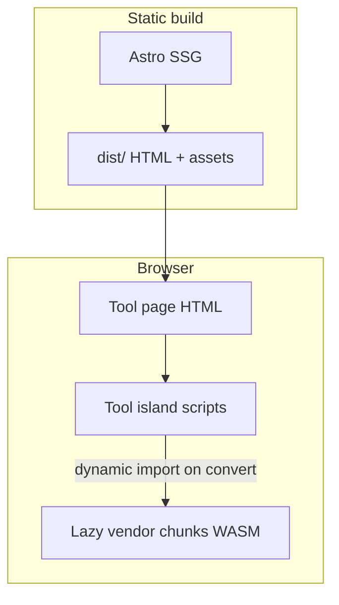

# AGENTS.md — LocalFile Convert

Privacy-first **niche file converters** (Astro 7 static site). All conversion runs in the browser.

## Governing guidelines

| Doc | Purpose |
|---|---|
| [docs/SEO-PLAYBOOK.md](docs/SEO-PLAYBOOK.md) | SEO, technical, GEO, AdSense synthesis |
| [docs/SEO-GUARDRAILS.md](docs/SEO-GUARDRAILS.md) | Hard do/don’t: site URL, og:image, sitemap alias, IndexNow, wrangler preview |
| [docs/CUSTOM-DOMAIN.md](docs/CUSTOM-DOMAIN.md) | Cutover: single `PUBLIC_SITE_URL`, Cloudflare domain, 301, GSC |
| [docs/CONTACT-EMAILJS.md](docs/CONTACT-EMAILJS.md) | Optional `/contact/` EmailJS form (public key only) |
| [docs/SEO-GUARDRAILS.md](docs/SEO-GUARDRAILS.md) | Title/desc length + llms.txt guide coverage CI |
| [docs/MARKET-RESEARCH.md](docs/MARKET-RESEARCH.md) | Niche selection evidence |
| [docs/KEYWORD-MAP.md](docs/KEYWORD-MAP.md) | One primary keyword per URL |
| [docs/ideas/README.md](docs/ideas/README.md) | 23 ranked ideas + backlog |

**Live progress:** [PROGRESS.md](PROGRESS.md) on the working branch.

### SEO / Workers hard rules (never regress)

- **Single origin:** `PUBLIC_SITE_URL` or `DEFAULT_SITE_URL` in `src/config/site.ts` — used for canonicals, sitemap, robots, llms.txt, JSON-LD, OG, IndexNow. **Never** hardcode `*.workers.dev` elsewhere (audit fails). Custom domain cutover: [docs/CUSTOM-DOMAIN.md](docs/CUSTOM-DOMAIN.md).
- Default origin today is live workers.dev — **never** `example.com`.
- `absoluteUrl()` must not append `/` to file assets (`og:image`, etc.).
- Ship `public/_redirects`: `/sitemap.xml` → `/sitemap-index.xml` 301.
- IndexNow: real `public/<32-hex>.txt` at site root (no `000…0` placeholder).
- `wrangler.jsonc`: worker `main` + `run_worker_first` (308 slash redirects, FILE_EXT `{1,16}`) + `html_handling: "force-trailing-slash"` + empty `"previews": {}`; no top-level `vars` for `PUBLIC_*`.
- Titles ≤60; meta descriptions 50–165; tool pages need Hammad byline + FAQPage + topical guide link; guides ≥800 words.
- `/_astro/*` immutable `Cache-Control` in `public/_headers`.
- After build: `npm run audit` (includes `seo-guardrails.mjs`) must pass.

## Architecture



- **Config:** `src/config/site.ts` — brand, domain (workers.dev default), AdSense, GA4, GSC, IndexNow.
- **Tools metadata + long-form SEO:** `src/data/tools.ts`
- **Guides:** `src/data/guides.ts`
- **Converters:** `src/lib/converters/*` (tested with Vitest)
- **UI:** `src/components/tools/*`, shell `ToolChrome.astro`
- **Layouts:** `BaseLayout.astro`, `ToolLayout.astro`
- **Audits:** `scripts/audit/*`, `npm run audit`

## Commands

| Command | Purpose |
|---|---|
| `npm run dev` | Dev server (Node 22.22 via `scripts/run-astro.mjs`) |
| `npm run build` | Production build + `postbuild` robots/llms patch |
| `npm test` | Vitest converter tests |
| `npm run audit` | SEO + SEO guardrails + page checklist + AdSense + bundles + link check |
| `npm run audit:pages` | Per-page checklist only (titles, canonical, JSON-LD, sitemap, stubs, answer-first) |
| `npm run deploy:indexnow` | `wrangler deploy` then IndexNow ping |
| `npm run preview:worker` | `wrangler preview` (needs `"previews": {}`) |
| `npm run lighthouse` | LHCI mobile budgets |
| `npm run screenshots` | 360px Playwright captures → `artifacts/screenshots/` |

## New pages: research first

Before adding or rewriting a tool, guide, or hub page:

1. Confirm one primary query + intent; check `docs/KEYWORD-MAP.md` for cannibalization.
2. Skim top results and list 3–6 PAA-style questions (FAQ/H2s).
3. Follow `.cursor/rules/seo-pages.mdc` and the shared per-page checklist (answer-first, schema, mobile 390×844, no ad stubs, no unsupported offline claims).
4. Run `npm run audit` (includes `audit:pages` / `scripts/audit/page-checklist.mjs`) — CI fails the PR on checklist breaks.

## Add a converter (summary)

See skill `.cursor/skills/add-new-converter/SKILL.md`.

1. `docs/KEYWORD-MAP.md` row  
2. `src/data/tools.ts` entry (full content)  
3. `src/lib/converters/<x>.ts` + tests  
4. `src/components/tools/<X>Tool.astro` (lazy libs)  
5. Wire `[slug].astro` / embed if needed  
6. `npm test && npm run build && npm run audit`

## Subagents (`.cursor/agents/`)

| Agent | Role |
|---|---|
| `seo-auditor` | Post-build SEO + links |
| `content-writer` | tools.ts / guides.ts copy |
| `adsense-reviewer` | AdSense readiness audit |
| `performance-auditor` | Bundles + Lighthouse |
| `link-builder-researcher` | Off-page ideas |
| `converter-qa` | Tests + smoke checks |

Same roles can be used in other tools (Codex, Claude Code) by pointing at this file.

## Definition of done

- [ ] 14 working converters, client-side, documented limits (MP3→MIDI and DWG skipped with reason)
- [ ] Trust pages, 6 guides, hubs, embeds, sitemap/robots/schema/OG
- [ ] `npm test`, `npm run build`, `npm run audit`, `npm run lighthouse` pass
- [ ] Docs: README, DEPLOYMENT, SEO-GUIDE, ADSENSE, KEYWORD-MAP, ideas index
- [ ] AGENTS.md + `.cursor` skills/rules/agents
- [ ] PR to `main` ready for review with Lighthouse + screenshots
- [ ] `PROGRESS.md` at 100% and pushed

## Dev server

```
npm run dev
```

Uses Node 22.22 through `scripts/run-astro.mjs`.
