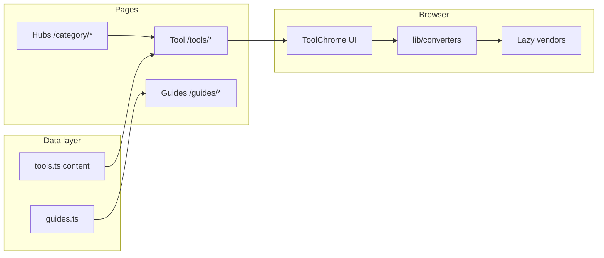

# LocalFile Convert

Production-ready **niche file converters** that run **100% in the browser** — no uploads, privacy-first. Built with Astro + TypeScript for static hosting (Cloudflare Pages, Vercel, Netlify).

## Goals

- Rank for low-KD **format-pair** keywords (see [docs/MARKET-RESEARCH.md](docs/MARKET-RESEARCH.md))
- Pass technical SEO + AdSense readiness ([docs/SEO-PLAYBOOK.md](docs/SEO-PLAYBOOK.md))
- Stay fast on mobile via lazy-loaded WASM/vendor chunks
- Remain easy for humans and AI agents to extend ([AGENTS.md](AGENTS.md))

## Converter list

| Tool | Path | Input → Output | Limits (summary) |
|---|---|---|---|
| YAML → JSON | [/tools/yaml-to-json/](src/pages/tools/) | `.yaml` → `.json` | JSON_SCHEMA; large files may slow tab |
| JSON → YAML | `/tools/json-to-yaml/` | `.json` → `.yaml` | Valid JSON only |
| JSON → CSV | `/tools/json-to-csv/` | JSON array → `.csv` | Shallow objects |
| CSV → JSON | `/tools/csv-to-json/` | `.csv` → JSON | Strings preserved |
| XML → JSON | `/tools/xml-to-json/` | `.xml` → `.json` | `@_` attribute prefix |
| TOML → JSON | `/tools/toml-to-json/` | `.toml` → `.json` | TOML v1 types |
| Markdown → HTML | `/tools/markdown-to-html/` | `.md` → `.html` | Sanitize if untrusted MD |
| PSD → PNG | `/tools/psd-to-png/` | `.psd` → `.png` | ag-psd composite; not Photoshop-perfect |
| HEIC → JPG | `/tools/heic-to-jpg/` | `.heic` → `.jpg` | WASM; primary frame |
| WebP ↔ PNG ↔ JPG | `/tools/image-format-converter/` | raster ↔ raster | JPEG flattens alpha |
| SVG → PNG | `/tools/svg-to-png/` | `.svg` → `.png` | No external URL deps |
| STL → OBJ + viewer | `/tools/stl-to-obj/` | `.stl` → `.obj`/STL | Educational viewer |
| STL → G-code (basic) | `/tools/stl-to-gcode/` | `.stl` → `.gcode` | **Not** a production slicer |
| PDF bank statement → CSV | `/tools/pdf-bank-statement-to-csv/` | text PDF → `.csv` | No OCR; verify amounts |

**Skipped by design:** MP3/WAV→MIDI (no reliable client-side approach), DWG (no trustworthy in-browser library). Documented in FAQs and [docs/ideas/README.md](docs/ideas/README.md).

## Tech stack

- **Astro 7** static output, trailing slashes, `@astrojs/sitemap`
- **TypeScript** strict
- **Vitest** for converter logic
- **Cheerio** SEO/AdSense audits on `dist/`
- **Lighthouse CI** mobile budgets (`lighthouserc.cjs`)
- **Playwright** screenshot script

### Architecture



## Folder structure

```
src/config/site.ts       # Single owner config (domain, ads, analytics)
src/data/tools.ts        # Tool registry + SEO body copy
src/data/guides.ts       # Guide articles
src/lib/converters/      # Pure conversion functions
src/components/tools/    # Tool UIs (islands)
src/layouts/             # BaseLayout, ToolLayout
src/pages/               # Routes (tools, guides, category, embed)
public/                  # robots, ads.txt, _headers, llms.txt, indexnow
scripts/audit/           # npm run audit
tests/converters/        # Vitest + fixtures
docs/                    # DEPLOYMENT, SEO-GUIDE, ADSENSE, research
.cursor/                 # skills, rules, agents for Cursor
```

## Prerequisites

- **Node.js 22.22+** (`.nvmrc`) — `scripts/run-astro.mjs` bootstraps via `npx` if needed
- npm 10+

## Local setup

```bash
npm ci
npm run dev
# http://localhost:4321
```

## Scripts

| Script | Description |
|---|---|
| `npm run dev` | Astro dev server |
| `npm run build` | Static `dist/` + postbuild URL patch |
| `npm run preview` | Preview production build |
| `npm test` | Vitest |
| `npm run audit` | SEO + AdSense + bundle + link checks |
| `npm run audit:seo` | SEO only |
| `npm run audit:adsense` | Trust/thin-page checks |
| `npm run audit:bundles` | ≤50 KB gzip initial JS per HTML page |
| `npm run link-check` | Internal links in `dist/` |
| `npm run lighthouse` | Build + LHCI mobile |
| `npm run screenshots` | 360px PNGs in `artifacts/screenshots/` |
| `npm run ci` | test + build + audit + lighthouse |

## Configuration

All owner-specific values live in **`src/config/site.ts`** (overridable via env at build time). Copy **[`.env.example`](.env.example)** to `.env` for local builds; set the same vars in Cloudflare Workers Builds for production (`PUBLIC_SITE_URL` is required there).

| Field / env | Description |
|---|---|
| `name`, `tagline`, `organizationName` | Brand strings |
| `PUBLIC_SITE_URL` → `url` | Canonical origin (HTTPS, no trailing slash) |
| `PUBLIC_CONTACT_EMAIL` → `contactEmail` | Public support email (Contact, legal pages, footer, schema) |
| `PUBLIC_ADSENSE_PUBLISHER_ID` | Empty = ads disabled |
| `adsenseAutoAds` | Auto ads flag when ID set |
| `PUBLIC_GA4_MEASUREMENT_ID` | Analytics |
| `PUBLIC_GSC_VERIFICATION` | Search Console meta |
| `PUBLIC_BING_VERIFICATION` | Bing meta |
| `PUBLIC_INDEXNOW_KEY` | IndexNow key file name/content |
| `defaultOgImage` | OG image path |
| `lastUpdated` | Sitemap/content stamp |

See [docs/DEPLOYMENT.md](docs/DEPLOYMENT.md) for host env setup.

## Add a converter or article

**Converter:** follow [AGENTS.md](AGENTS.md) and `.cursor/skills/add-new-converter/SKILL.md`.

**Article:** add to `src/data/guides.ts`, create route via `src/pages/guides/[slug].astro` (static paths), link from tools/hubs, update `docs/KEYWORD-MAP.md`.

## Testing

```bash
npm test
```

Fixtures in `tests/fixtures/`. Covers YAML/JSON, CSV, XML/TOML, STL, PDF bank heuristics, Markdown.

## Audits & CI

```bash
npm run build && npm run audit
```

GitHub Actions (`.github/workflows/ci.yml`): `npm run proof` on PRs (uploads `docs/proof/` artifact).

## Proof

Committed, reproducible SEO/performance/AdSense evidence lives in **[docs/proof/](docs/proof/README.md)**.

Regenerate locally (never hand-edit scores):

```bash
npm run proof
```

This runs tests, audits, Lighthouse (mobile + desktop samples), JSON-LD extraction/validation, sitemap/robots checks, bundle budgets, mobile screenshots, and writes `docs/proof/README.md` with pass/fail vs budgets.

**Performance approach:** heavy libraries (`pdfjs-dist`, `ag-psd`, `heic2any`, `three`) are **not** in the initial HTML bundle; tool scripts `import()` them on convert. `scripts/audit/bundle-audit.mjs` enforces ≤50 KB gzip for script tags referenced in each page’s HTML.

## SEO / AI-SEO summary

- Keyword map: [docs/KEYWORD-MAP.md](docs/KEYWORD-MAP.md)
- Hubs → tools → guides cluster; breadcrumbs + JSON-LD
- Answer-first copy, FAQs, cited sources (no fake FAQ rich results)
- `robots.txt` allows search + AI-search bots; optional `llms.txt`
- Post-launch: [docs/SEO-GUIDE.md](docs/SEO-GUIDE.md) (GSC, sitemap, IndexNow, Bing)

## AdSense summary

Placeholder slots, `ads.txt` template, privacy disclosures — ads off until `PUBLIC_ADSENSE_PUBLISHER_ID` is set. Details: [docs/ADSENSE.md](docs/ADSENSE.md).

## Deployment

**Full beginner guide:** [docs/DEPLOYMENT.md](docs/DEPLOYMENT.md) — DNS, Cloudflare Pages (primary), Vercel/Netlify, GSC/Bing/IndexNow, AdSense, GA4, rollback, and launch checklist.

## Docs index

| File | Description |
|---|---|
| [docs/DEPLOYMENT.md](docs/DEPLOYMENT.md) | Deploy + env vars |
| [docs/SEO-GUIDE.md](docs/SEO-GUIDE.md) | Launch & 90-day SEO |
| [docs/ADSENSE.md](docs/ADSENSE.md) | AdSense checklist |
| [docs/SEO-PLAYBOOK.md](docs/SEO-PLAYBOOK.md) | Full SEO/GEO playbook |
| [docs/MARKET-RESEARCH.md](docs/MARKET-RESEARCH.md) | Market research |
| [docs/KEYWORD-MAP.md](docs/KEYWORD-MAP.md) | URL → keyword map |
| [docs/ideas/README.md](docs/ideas/README.md) | 23 ideas index + backlog |
| [AGENTS.md](AGENTS.md) | Agent/human contributor guide |
| `.cursor/skills/*` | Cursor skills (converter, SEO, audits, …) |
| `.cursor/rules/*` | Cursor rules (SEO, privacy, perf, a11y) |
| `.cursor/agents/*` | Subagent role prompts |

## Troubleshooting

| Issue | Fix |
|---|---|
| `Node.js … not supported by Astro` | Use Node 22.22+ or `npm run build` (uses `run-astro.mjs`) |
| Audit: thin tool page | Expand copy in `src/data/tools.ts` |
| Lighthouse LCP ~2s on tool pages | Long SEO HTML; perf score still ≥99; see `content-visibility` in CSS |
| HEIC/PSD fails | Update browser; WASM must be allowed |
| PDF CSV empty | PDF is scanned — needs OCR first |

## Roadmap

- [ ] Owner: real domain, email, AdSense/GA4/GSC IDs in `site.ts`
- [ ] Backlog: 3D printing cost calculator ([docs/ideas/README.md](docs/ideas/README.md))
- [ ] Re-evaluate DWG / MP3→MIDI if client-side libraries mature

## License

Source is provided for deployment by the repository owner. **No license grant is implied** unless the owner adds a `LICENSE` file. Third-party libraries retain their respective licenses.

## Progress

See [PROGRESS.md](PROGRESS.md) on the active branch for live build status.
